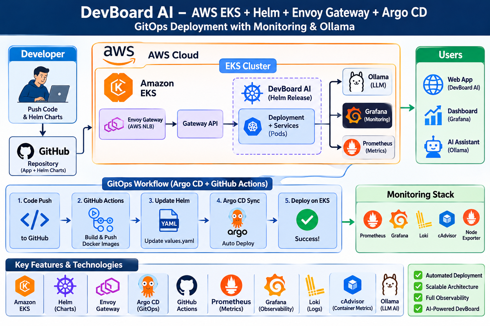
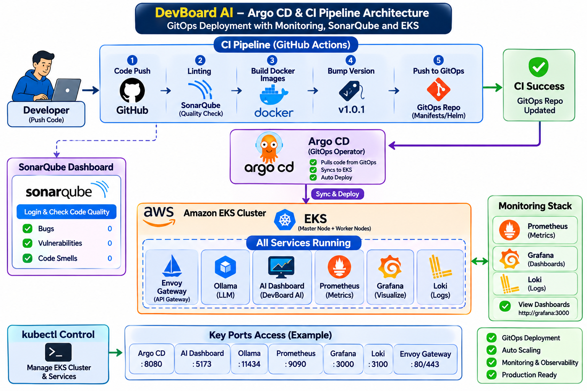
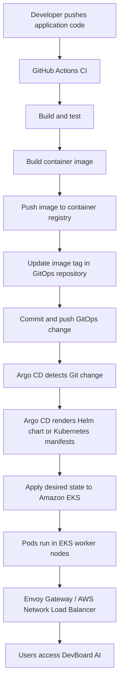
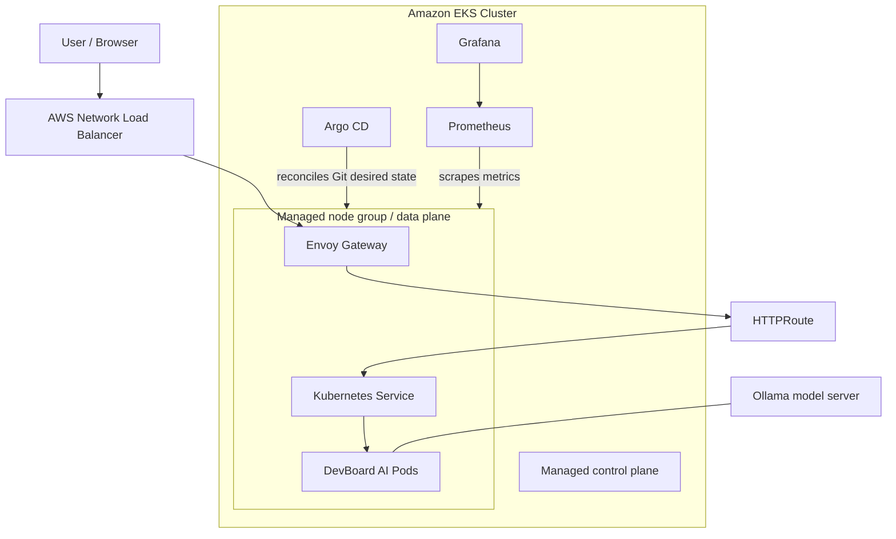

> **Important security note:** The original notes contained an Argo CD/Grafana credential and recommended opening management ports to `0.0.0.0/0`. Those credentials are intentionally not reproduced here. Rotate any password that was exposed in notes, terminal history, screenshots, or chat. Restrict management access to your own IP or use a VPN/bastion/SSM. Do not commit credentials to Git.

## 1. Architecture overview

### Platform and deployment flow



### EKS and observability components



**Responsibility summary**

- **AWS / EKS:** AWS manages the EKS control plane. You manage the Kubernetes workloads and the supporting AWS infrastructure/configuration.
- **eksctl:** Creates and deletes EKS clusters and node groups.
- **kubectl:** Communicates with the Kubernetes API server to inspect and manage cluster resources.
- **Helm:** Packages Kubernetes resources into reusable charts. Chart templates define resources; `values.yaml` supplies configurable values.
- **Envoy Gateway:** Implements the Kubernetes Gateway API and can provision an AWS Network Load Balancer when configured for AWS.
- **Argo CD:** Watches the Git repository and reconciles the cluster with the desired state stored in Git.
- **Prometheus and Grafana:** Collect metrics and display dashboards.
- **Ollama:** Runs the shared model-server workload in its own namespace, as described in the lab notes.

## 2. Prerequisites

You need:

- An AWS account and an IAM identity with the permissions required to create EKS, EC2, VPC, IAM roles, CloudFormation stacks, and related resources.
- AWS CLI v2, `eksctl`, `kubectl`, Helm, Git, and access to the DevBoard AI Git repository.
- An SSH/SSM access method for the EC2 administration host, if you use one.
- A container registry to which the CI workflow can push images.

The original lab listed these broad policies:

- `AdministratorAccess`
- `AmazonEC2FullAccess`
- `AmazonS3FullAccess`
- `AmazonVPCFullAccess`

These are broad permissions and are **not** a least-privilege recommendation. For a real environment, use narrowly scoped IAM policies and the required EKS/CloudFormation/IAM permissions. Do not attach every policy by default.

## 3. Install and configure AWS CLI v2

Run on the Ubuntu administration machine:

```bash
sudo apt-get update
sudo apt-get install -y curl unzip

curl -sL "https://awscli.amazonaws.com/awscli-exe-linux-x86_64.zip" -o awscliv2.zip
unzip -q awscliv2.zip
sudo ./aws/install

aws --version
```

Configure credentials using your approved method:

```bash
aws configure
```

Enter the access key, secret key, default region (the lab uses `us-west-2`), and output format when prompted. Prefer an IAM role/instance profile or another short-lived credential method over long-lived access keys where possible.

Verify identity and access:

```bash
aws sts get-caller-identity
aws s3 ls
```

If a command returns `AccessDenied`, check the IAM identity, attached policies, permission boundaries, and service-specific role permissions.

## 4. Install eksctl

```bash
curl -sLO "https://github.com/eksctl-io/eksctl/releases/latest/download/eksctl_$(uname -s)_amd64.tar.gz"
tar -xzf eksctl_*.tar.gz
sudo mv eksctl /usr/local/bin/
eksctl version
```

## 5. Install kubectl

```bash
curl -sLO "https://dl.k8s.io/release/$(curl -sL https://dl.k8s.io/release/stable.txt)/bin/linux/amd64/kubectl"
sudo install -m 0755 kubectl /usr/local/bin/kubectl

kubectl version --client
```

## 6. Create the EKS cluster

### Option A — Create using a command

The lab's example creates a cluster named `dev-cluster` in `us-west-2` with a managed node group:

```bash
eksctl create cluster \
  --name dev-cluster \
  --version 1.34 \
  --region us-west-2 \
  --nodegroup-name standard-workers \
  --node-type t3.medium \
  --nodes 3 \
  --nodes-min 1 \
  --nodes-max 4 \
  --managed
```

Kubernetes and EKS versions change over time. Before running this command, confirm that the requested Kubernetes version is currently supported in the selected AWS region.

### Option B — Create using `cluster.yml`

The lab also used a declarative cluster configuration. Save the following as `cluster.yml`:

```yaml
apiVersion: eksctl.io/v1alpha5
kind: ClusterConfig

metadata:
  name: devboard
  region: us-west-2

iam:
  withOIDC: true

managedNodeGroups:
  - name: ng-default
    instanceType: t3.medium
    desiredCapacity: 3
    minSize: 2
    maxSize: 3
    volumeSize: 20
    ssh:
      enableSsm: true

addons:
  - name: vpc-cni
  - name: coredns
  - name: kube-proxy
  - name: aws-ebs-csi-driver
    wellKnownPolicies:
      ebsCSIController: true
```

Then create the cluster:

```bash
eksctl create cluster -f cluster.yml
```

The original notes also listed a metrics-server add-on. Add it only if you have verified the correct add-on/chart installation method for your cluster; the spelling in the notes (`matrics--server`) is not a valid add-on name.

### Verify the cluster

```bash
eksctl get clusters
kubectl get nodes
kubectl get pods -A
kubectl run nginx --image=nginx
kubectl get pods
```

The `nginx` command creates a test pod in the current namespace. Remove it after testing:

```bash
kubectl delete pod nginx
```

### Delete a lab cluster

Only run this when you intend to destroy the cluster and its managed resources:

```bash
eksctl delete cluster --name devboard --region us-west-2
```

`eksctl` uses AWS CloudFormation to manage many of the resources it creates. Check for remaining load balancers, volumes, or other billable resources after deletion.

## 7. Install Helm

```bash
curl -fsSL https://raw.githubusercontent.com/helm/helm/main/scripts/get-helm-3 | bash
helm version
```

Create a starter chart:

```bash
helm create devboard-dummy
cd devboard-dummy
ls
```

Typical chart structure:

```text
devboard-dummy/
├── Chart.yaml
├── charts/
├── templates/
└── values.yaml
```

Package and install a chart:

```bash
helm package .
helm install my-nginx ./my-nginx-0.1.0.tgz
kubectl get pods
helm uninstall my-nginx
```

Use the actual generated package filename shown by `helm package`. The lab observed two pods from its chart configuration; replica count is controlled by the chart values/templates.

**Helm concept:** Put environment-specific values such as image, tag, replica count, service type, and resource settings in `values.yaml`. Templates use those values to render Kubernetes manifests.

Useful commands:

```bash
helm list -A
helm get values <release-name> -n <namespace>
helm template <release-name> <chart-path> -f values.yaml
helm upgrade --install <release-name> <chart-path> -n <namespace> --create-namespace
helm uninstall <release-name> -n <namespace>
```

## 8. Install Envoy Gateway and configure Gateway API

The lab installed Envoy Gateway with Helm:

```bash
helm install eg oci://docker.io/envoyproxy/gateway-helm \
  --version v1.2.1 \
  -n envoy-gateway-system \
  --create-namespace

kubectl get all -n envoy-gateway-system
kubectl -n envoy-gateway-system rollout status deploy/envoy-gateway
```

Check the current Envoy Gateway compatibility and installation instructions before reusing the pinned version in a new cluster.

Create `gateway-class.yml`:

```yaml
apiVersion: gateway.networking.k8s.io/v1
kind: GatewayClass
metadata:
  name: envoy
spec:
  controllerName: gateway.envoyproxy.io/gatewayclass-controller
```

Apply and verify:

```bash
kubectl apply -f gateway-class.yml
kubectl get gatewayclass
```

The Gateway API resources have different roles:

- **GatewayClass:** identifies the controller that implements the Gateway.
- **Gateway:** defines listeners and the entry point for traffic.
- **HTTPRoute:** defines host/path routing rules to Kubernetes Services.

A `GatewayClass` alone does not create a working application route. You also need a `Gateway`, appropriate `HTTPRoute` resources, Services, and the controller's required configuration. For AWS NLB provisioning, verify the Envoy Gateway service annotations and AWS integration settings.

## 9. Install Argo CD

Add the Helm repository:

```bash
helm repo add argo https://argoproj.github.io/argo-helm
helm repo update
helm repo list
```

Create `gitops/argocd/install-values.yaml`:

```yaml
configs:
  params:
    server.insecure: "true"
```

> This setting disables TLS between the client and Argo CD server. Use it only behind a properly secured TLS-terminating proxy/load balancer or for a controlled lab. Do not expose the Argo CD UI publicly over plain HTTP.

Install Argo CD:

```bash
helm install argocd argo/argo-cd \
  -n argocd \
  --create-namespace \
  -f gitops/argocd/install-values.yaml

kubectl get pods -n argocd
kubectl rollout status deployment/argocd-server -n argocd
```

### Access the Argo CD UI

For a temporary lab-only access method, use port-forwarding:

```bash
kubectl port-forward svc/argocd-server -n argocd 8080:443
```

Open `https://localhost:8080` from the same machine. If you run the command on a remote EC2 host, use an SSH tunnel rather than opening port `8080` to the entire internet.

Retrieve the initial admin password:

```bash
kubectl -n argocd get secret argocd-initial-admin-secret \
  -o jsonpath='{.data.password}' | base64 -d
echo
```

Username is `admin`. Change the initial password after first login and store it in a password manager or secret manager. Do not put it in this README or Git.

## 10. Register the DevBoard application in Argo CD

The lab's `application.yml` points Argo CD at the `gitops` branch and the `k8s` directory. Confirm that this branch and path exist in your repository before applying.

```yaml
apiVersion: argoproj.io/v1alpha1
kind: Application
metadata:
  name: devboard
  namespace: argocd
spec:
  project: default
  source:
    repoURL: https://github.com/anandkumarprajap/Devboard_AI.git
    targetRevision: gitops
    path: k8s
  destination:
    server: https://kubernetes.default.svc
    namespace: devboard
  syncPolicy:
    automated:
      prune: true
      selfHeal: true
    syncOptions:
      - CreateNamespace=true
```

Apply:

```bash
kubectl apply -f gitops/argocd/application.yml
kubectl get applications -n argocd
kubectl get pods -n devboard
```

What the sync policy means:

- `automated`: Argo CD automatically applies detected Git changes.
- `prune: true`: resources removed from the desired Git state may be deleted from the cluster.
- `selfHeal: true`: Argo CD attempts to correct live-cluster drift.
- `CreateNamespace=true`: creates the destination namespace if it does not exist.

Be careful with `prune`: deleting a manifest from Git can delete the corresponding live Kubernetes resource.

## 11. Install Prometheus and Grafana

The lab used the `kube-prometheus-stack` chart:

```bash
helm install kube-prom-stack \
  oci://ghcr.io/prometheus-community/charts/kube-prometheus-stack

kubectl get svc
```

For a temporary local test, port-forward Grafana:

```bash
kubectl port-forward svc/kube-prom-stack-grafana 8081:80
```

Open `http://localhost:8081` from the same machine. Avoid opening port `8081` to `0.0.0.0/0`.

Retrieve the Grafana admin password from the Kubernetes Secret rather than copying a password into notes:

```bash
kubectl get secret -n default \
  -l app.kubernetes.io/component=admin-secret \
  -o jsonpath='{.items[0].data.admin-password}' | base64 --decode
echo
```

The namespace and Secret name can differ depending on chart version and installation options. If this command returns nothing, locate the relevant Secret:

```bash
kubectl get secrets -A | grep -i grafana
```

Sign in with username `admin` unless you configured a different username. In Grafana, explore the Kubernetes dashboards and filter for the `devboard` namespace.

## 12. Deploy the shared Ollama model server with Argo CD

The lab defines Ollama as a shared platform workload in its own namespace. Save the following as `gitops/argocd/ollama.yml`:

```yaml
apiVersion: argoproj.io/v1alpha1
kind: Application
metadata:
  name: ollama
  namespace: argocd
spec:
  project: default
  source:
    repoURL: https://github.com/anandkumarprajap/Devboard_AI.git
    targetRevision: gitops
    path: gitops/ollama
  destination:
    server: https://kubernetes.default.svc
    namespace: ollama
  syncPolicy:
    automated:
      prune: true
      selfHeal: true
    syncOptions:
      - CreateNamespace=true
```

Apply and inspect:

```bash
kubectl apply -f gitops/argocd/ollama.yml
kubectl get applications -n argocd
kubectl get all -n ollama
kubectl get pods -n ollama
```

The lab notes expect the Ollama manifests to be stored under `gitops/ollama`. Ensure that directory contains the required Deployment, Service, PVC, and namespace resources (or equivalent chart templates). The DevBoard AI service must be configured to use the Ollama Service DNS name and port; the exact environment variable and service name are project-specific and are not specified in these notes.

## 13. CI and GitOps workflow

The intended workflow is:

1. Developer pushes application code to the application source branch.
2. GitHub Actions runs CI checks and tests.
3. CI builds a container image and pushes it to the registry.
4. CI updates the image tag in the GitOps deployment configuration.
5. CI commits and pushes that GitOps change.
6. Argo CD detects the Git change and refreshes the Application.
7. Argo CD applies the desired manifests/Helm chart to EKS.
8. Kubernetes performs the rollout and the Gateway/NLB routes traffic to healthy Services and Pods.

### Suggested repository separation

This is a suggested organization; adapt it to the actual repository:

```text
Devboard_AI/
├── .github/
│   └── workflows/
│       └── ci.yml
├── k8s/                       # Kubernetes manifests, if using raw YAML
├── charts/
│   └── devboard/              # Helm chart, if using Helm
└── gitops/
    ├── argocd/
    │   ├── application.yml
    │   ├── ollama.yml
    │   └── install-values.yaml
    ├── gateway/
    └── ollama/
```

### CI workflow responsibilities

A GitHub Actions workflow should perform these logical stages:

```text
Checkout source
    |
    v
Install dependencies
    |
    v
Run lint / tests
    |
    v
Build container image
    |
    v
Authenticate to registry using GitHub Secrets
    |
    v
Push image with an immutable tag (for example, commit SHA)
    |
    v
Update image tag in GitOps manifest or Helm values
    |
    v
Commit and push GitOps change
    |
    v
Argo CD detects Git change and syncs EKS
```

The actual workflow YAML depends on the project's Docker build context, image names, registry, manifest paths, and branch strategy. Those values are not included in the source notes, so they must be filled in from the repository rather than guessed.

**Recommended practice:** Use an immutable image tag such as the Git commit SHA instead of relying only on `latest`. Store registry credentials and Git write credentials in GitHub Actions Secrets. Give the workflow only the minimum permissions it needs. Do not store AWS keys, registry passwords, or Argo CD admin passwords in source files.

## 14. Validation and troubleshooting checklist

Run these checks after deployment:

```bash
# AWS identity and cluster
aws sts get-caller-identity
eksctl get clusters
kubectl get nodes

# Workloads and services
kubectl get pods -A
kubectl get svc -A
kubectl get deployments -A

# Argo CD
kubectl get applications -n argocd
kubectl get pods -n argocd

# Gateway API
kubectl get gatewayclass
kubectl get gateways -A
kubectl get httproutes -A

# DevBoard and Ollama
kubectl get all -n devboard
kubectl get all -n ollama

# Recent events
kubectl get events -A --sort-by=.metadata.creationTimestamp
```

Common checks:

- **Nodes are not Ready:** inspect node group health, EC2 capacity, VPC CNI, and node IAM permissions.
- **Pods are Pending:** inspect `kubectl describe pod <pod> -n <namespace>` for scheduling, storage, and resource issues.
- **ImagePullBackOff:** confirm the image repository/tag and registry pull permissions.
- **Argo CD OutOfSync:** inspect the Application in the UI and run `kubectl describe application devboard -n argocd`.
- **Gateway has no address:** inspect Gateway conditions, Envoy Gateway controller logs, Service annotations, and AWS load balancer events.
- **Grafana cannot show metrics:** verify Prometheus targets and Grafana's Prometheus data source.
- **Ollama is unavailable:** verify the Ollama Pod, Service, PVC, and the AI service's configured endpoint.

## 15. Cleanup

Remove application resources through Argo CD or by deleting the relevant Application only after understanding its finalizer and resource-deletion behavior. Remove lab-only releases and infrastructure when no longer needed.

Examples:

```bash
helm uninstall kube-prom-stack
helm uninstall argocd -n argocd
helm uninstall eg -n envoy-gateway-system
```

Delete an EKS cluster only when you intend to remove the entire lab environment:

```bash
eksctl delete cluster --name devboard --region us-west-2
```

Check AWS for leftover load balancers, EBS volumes, Elastic IPs, and other billable resources.

## 16. Important notes from the lab

- The command-based cluster example used `dev-cluster`; the YAML-based example used `devboard`. Choose one cluster name and use it consistently.
- The lab region was `us-west-2`. Keep the AWS CLI default region, `eksctl` region, and cluster configuration aligned.
- The Argo CD Application example watches branch `gitops` and path `k8s`; the Ollama Application watches branch `gitops` and path `gitops/ollama`.
- The lab used port-forwarding for Argo CD and Grafana. Port-forwarding is suitable for testing, not a permanent public access design.
- The original notes include an exposed Grafana password. Rotate it and keep all credentials out of documentation and Git.
- The exact CI workflow, image repository names, DevBoard Service names, Gateway/HTTPRoute manifests, and Ollama endpoint configuration were not included in the source notes. Confirm these from the repository before applying changes.
"""
out = "/mnt/data/DevBoard_AI_EKS_GitOps_README.md"
pypandoc.convert_text(readme, "md", format="md", outputfile=out, extra_args=["--standalone"])
print(out)
